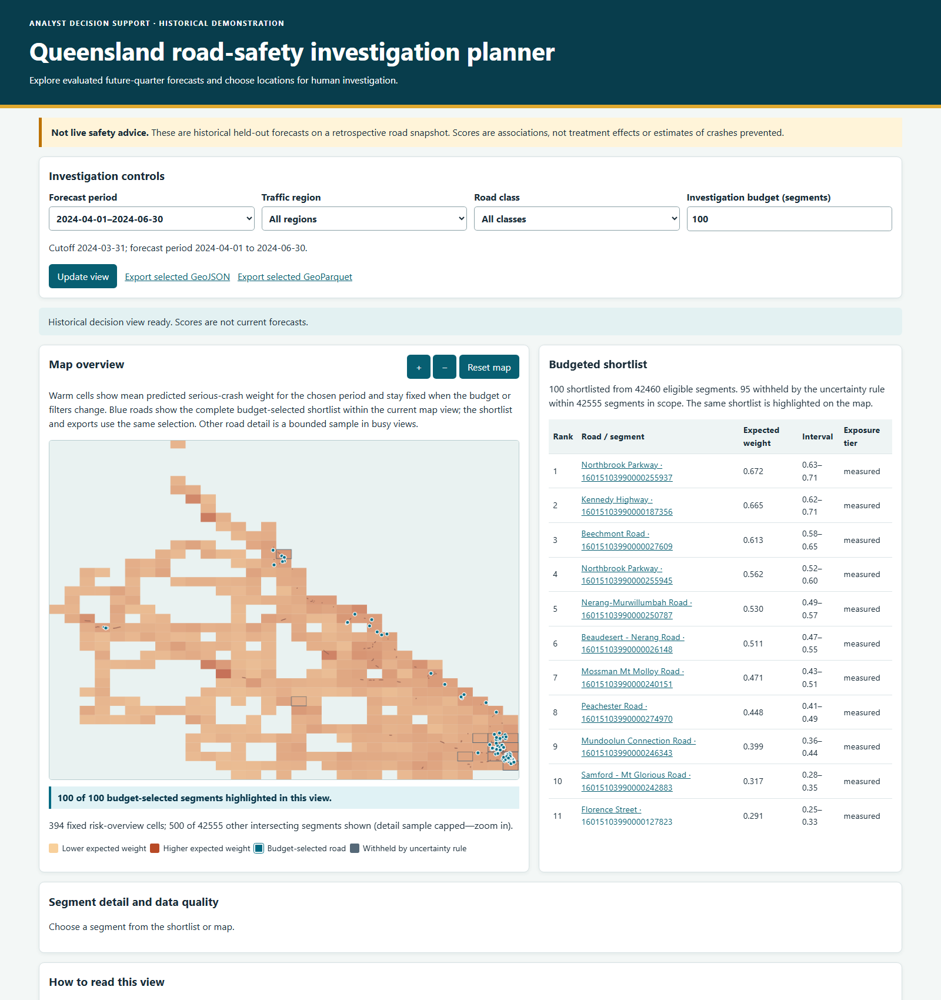
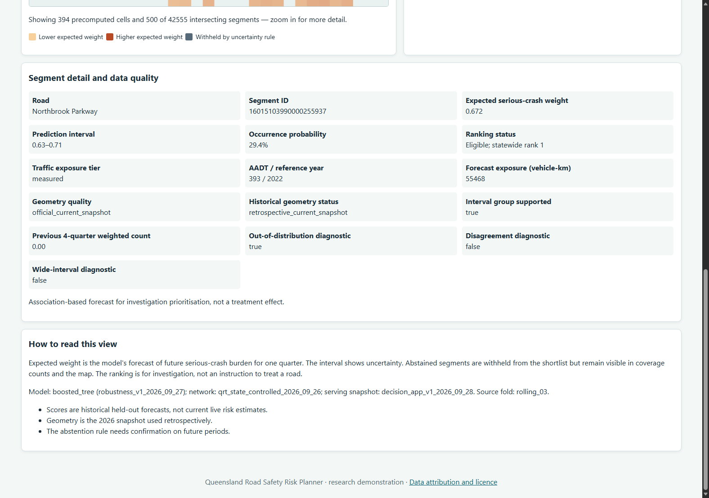

# Queensland Road Safety Risk Planner

A reproducible research demonstrator that forecasts **next-quarter serious-crash risk** on Queensland road segments and helps analysts choose locations for further investigation when capacity is limited.

This is **historical planning support**, not a live safety warning or an automatic treatment recommendation. A high score means “worth investigating,” not “an intervention here will prevent a known number of crashes.” The latest displayed forecast is **April–June 2024**; road geometry comes from a **retrospective 2026 network snapshot**.

## Project overview

Historical crash maps show where incidents were recorded, but traffic volume, reporting coverage and sparse events make those maps difficult to use as forecasts. This project estimates which **state-controlled road segments with verified traffic exposure** warrant further investigation in the next quarter. Its primary target is the fractional weight of reported fatal or hospitalisation crashes: when an event has several credible road matches, its weight is shared rather than counted multiple times.

The output is an uncertainty-aware ranking for analysts, not a declaration that unranked roads are safe. No model output estimates the effect of a road treatment or the number of crashes an intervention would prevent.

## System architecture

The research pipeline and the web application are deliberately separate. Data processing, model fitting, evaluation and calibration happen offline. The local application reads a precomputed, checksum-verified snapshot and never fits a model in response to a browser request.

```text
OFFLINE RESEARCH PIPELINE
Official Queensland sources + provenance
    → immutable raw snapshots
    → validated road/crash GeoParquet + traffic Parquet
    → road graph + point-in-time segment-quarter panel
    → baseline and graph experiments → temporal/geographic evaluation
    → calibrated historical scores + precomputed map cells
                                  │
                                  ▼ approved, checksummed bundle
LOCAL READ-ONLY APPLICATION
Score store → FastAPI → browser map | ranked shortlist | segment detail | exports
```

The [Python package](src/qld_road_safety/) separates acquisition, canonicalisation, map matching, panel construction, modelling, evaluation and serving. [Configuration](configs/base.yaml) fixes the study rules and version identifiers; [tests](tests/) cover temporal boundaries, spatial transformations, joins, model outputs and API behavior. The service verifies its bundle at startup and exposes only approved prediction and quality fields—never observed future outcomes.

## Data and modelling pipeline

1. **Audit and preserve sources.** Official crash, road and traffic files are inventoried with source URLs, retrieval times, licences and SHA-256 checksums. Raw files remain unchanged outside Git. The approved demo's crash-label cutoff is **30 June 2024**; a separate [post-2024 validation](docs/new_period_validation.md) tests later complete quarters without changing the app.
2. **Build the analytical geography.** The official Roads and Tracks `segment_id` identifies the current state-controlled network. Road geometry is stored in projected GeoParquet, and adjacent segments form a road graph. Crash points are map-matched with measured distances; ambiguous junction events retain multiple candidates whose allocation weights sum to one. Road-location evidence links segments to annual traffic counts.
3. **Create point-in-time examples.** Each panel row represents one segment at one quarterly cutoff. Lagged crash history, measured traffic exposure and road/network context are restricted to information available by that cutoff. The label belongs to the *following* quarter. Missing or stale exposure remains visible rather than silently imputed into the primary study population.
4. **Compare and select models.** Historical density and empirical-Bayes rates establish operational baselines, followed by exposure-aware Poisson regression and a Poisson LightGBM tree. A graph-feature tree and a compact GraphSAGE-style neural candidate are tested on the same evaluation folds. The ordinary boosted tree is retained because the graph alternatives do not provide a sufficient decision-focused or uncertainty benefit.
5. **Calibrate and publish a historical snapshot.** Chronological rolling origins and complete geographic holdouts measure fixed-budget crash capture, calibration, interval coverage, subgroup behavior and ranking stability. Count and occurrence estimates are calibrated; prediction intervals and abstention reasons are attached. Only the selected historical held-out scores, road geometry and precomputed multi-resolution map cells are packaged for the local app.

The network is a **retrospective 2026 snapshot**; it does not prove that every road alignment was the same at earlier cutoffs. All model outputs are associational forecasts. The [methodology](docs/methodology.md), [data contract](docs/data_contract.md) and [evaluation protocol](docs/evaluation_protocol.md) document the full scientific controls.

## Web demo

The browser presents a historical forecast period, a regional map overview, a budgeted shortlist and segment-level evidence. Warm overview cells show mean predicted serious-crash weight across the chosen period and stay fixed when the budget changes. **Blue road segments show the budget-selected shortlist on the map**; changing the budget updates both the shortlist and that overlay. Region and road-class filters apply to the shortlist, exports and segment layers, while the fixed overview stays statewide. All selected roads in the current map view are shown, even if the separate background road-detail sample is capped. Roads outside the current view are counted but not drawn until you pan or zoom there.



*Historical local decision view. Blue roads are the budget-selected shortlist; warm cells remain the fixed risk overview. The latest forecast covers April–June 2024, not current road conditions. Derived from Queensland Government open data; see [attribution](docs/attribution.md).*

A segment detail brings together expected serious-crash weight, occurrence probability, prediction interval, traffic exposure and reference year, geometry status and uncertainty diagnostics. Abstained segments are withheld from rankings but remain accounted for in coverage figures and map cells. Analysts can export the selected segments as GeoJSON or GeoParquet for further review.



*The detail view keeps uncertainty and data quality next to the score. It does not prescribe an intervention.*

## Run locally

On Windows PowerShell, with the approved local Milestone 6 scoring bundle already present:

```powershell
.\scripts\bootstrap.ps1
.\scripts\smoke_milestone6.ps1
.\scripts\serve_milestone6.ps1
```

Open [http://127.0.0.1:8000](http://127.0.0.1:8000) while the server terminal remains open. The address is local to the computer running the service. A fresh Git clone contains the code and documentation but **not** the raw data, processed panel, trained weights or real-data serving bundle, so it cannot display the historical Queensland map on its own. See [reproducibility](docs/reproducibility.md) for rebuild and startup requirements.

## Data sources

| Official Queensland source | Role in the study |
| --- | --- |
| Crash-location records | Locate historical fatal and hospitalisation crash events for future-quarter labels. |
| Queensland Roads and Tracks | Provide the road geometry and segment context needed for spatial matching and map display. |
| Road-location and traffic data; 2015–2025 traffic census | Identify state-controlled roads and provide measured traffic exposure, rather than mistaking high traffic volume for unusually high risk. |
| Source definitions and casualty summaries | Audit field meanings and aggregate consistency; not extra predictive outcome features. |

OpenStreetMap, weather and ABS area data were considered in the broader blueprint but **are not inputs to the delivered demonstrator**. Exact source files, licences, dates and coverage limitations are in [data sources](docs/data_sources.md), [attribution](docs/attribution.md) and the private local source manifest. No raw dataset is redistributed here.

## Evaluation and limitations

The analytical panel contains **877,662 segment-quarter rows**, covering **48,759 segments and 18 cutoffs**; **764,342 rows** meet the primary exposure-verified eligibility rule. The serving snapshot contains **170,220 segment-period scores** across four historical forecast cutoffs (**42,555** per cutoff). Those totals describe the approved local research build, not a promise that a fresh clone can reproduce them without the source data.

Models were compared over **three chronological rolling origins** and **four geographic holdouts**, including simple and operationally plausible baselines. The retained boosted tree captured **8.108%** of future serious-crash weight at a **top-1% investigation budget** in rolling-origin evaluation and **7.547%** on average across geographic holdouts. Calibration is not uniformly strong: Gold Coast interval coverage was **74.768%** against a **90%** target, and a historical out-of-distribution diagnostic shifted substantially (**PSI 1.387**). Both require review before any refreshed or operational use. Coverage and sensitivity analyses are documented in the [evaluation protocol](docs/evaluation_protocol.md), [methodology](docs/methodology.md) and [release checklist](docs/release_checklist.md).

An independent [July 2024–March 2025 temporal holdout](docs/new_period_validation.md) captured **7.819%** at the same top-1% budget with the selected tree. Its overall interval coverage was **89.205%**, but coverage on rows where a serious-crash outcome occurred was only **0.258%**. This is a research result and an **operational no-go**, not a refreshed model or a change to the historical web demo.

A follow-on [geographic uncertainty experiment](docs/geographic_uncertainty.md) improves the later-period South Coast all-row interval coverage from **79.053% to 89.694%** with region calibration, but worsens the Townsville geographic holdout. A separate positive-conditional bound covers **90.757%** of later positive outcomes, at a much larger span; it is not an unconditional interval. Neither experimental measure is served in the demo.

## Repository and verification

| Location | Purpose |
| --- | --- |
| [`PROJECT_BLUEPRINT.md`](PROJECT_BLUEPRINT.md), [`docs/`](docs/) | Research design, data contracts, source audit, decisions, limitations and release criteria. |
| [`configs/`](configs/) | Versioned pipeline and provenance configuration examples. |
| [`src/qld_road_safety/`](src/qld_road_safety/) | Separate acquisition, validation, canonicalisation, panel, modelling, evaluation and serving modules. |
| [`src/qld_road_safety/static/`](src/qld_road_safety/static/) | Local map interface and browser logic. |
| [`scripts/`](scripts/) | Environment setup, milestone smoke tests, local serving and verification. |
| [`tests/`](tests/) | Parser, temporal, geospatial, modelling, API and UI-contract checks using synthetic fixtures. |
| `data/`, `reports/` | Local source/derived data and review evidence; generated or private contents are excluded from Git. |

Python **3.12** is the tested release reference (3.11–3.13 are supported). For a code-only check after setup:

```powershell
.\scripts\verify.ps1
```

The verification suite includes **79 automated tests**, linting and type checks. Linux, Windows and container CI checks passed on the release-review commit; the container check used synthetic data. Local Docker Compose runtime, a human screen-reader review and an optional owner-created release tag remain on the [release checklist](docs/release_checklist.md). There is no scheduled data refresh or automatic model promotion; the [refresh operations](docs/refresh_operations.md) document is a governed design only.

The code is MIT-licensed. Source-data attribution and adaptation notices are in [docs/attribution.md](docs/attribution.md). Keep this work in the role it was built for: an auditable research and investigation aid, with human judgment and fresh data checks before any operational use.
