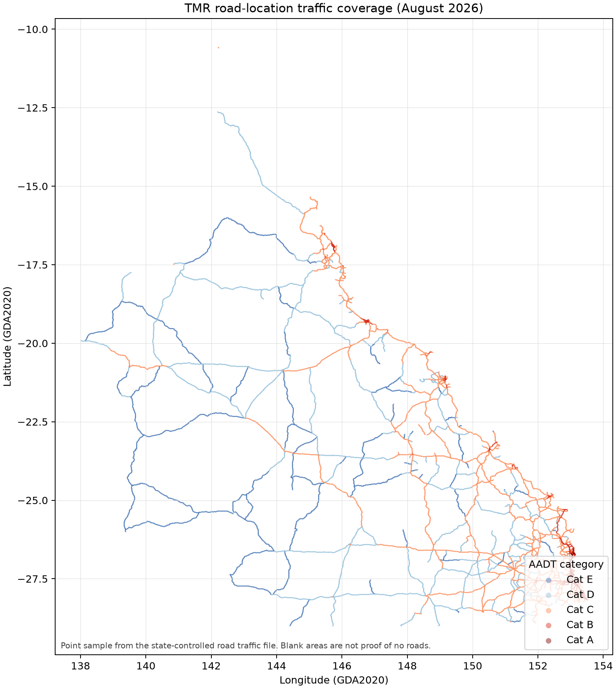
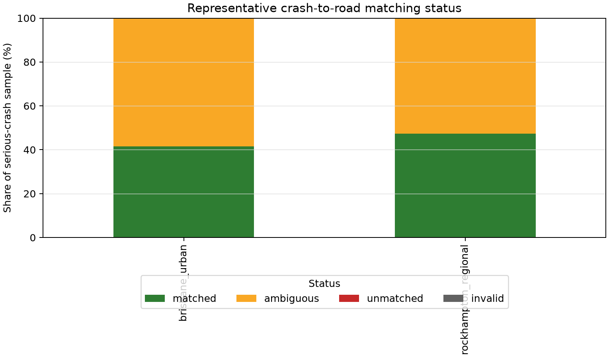

# Milestone 1 Map-Matching and Exposure Feasibility

## Plain-language result

The official road geometry is close enough to almost every sampled serious-crash point, but a
simple nearest-road assignment would frequently choose between several equally plausible segments
at intersections. This is an ambiguity problem, not a missing-map problem.

Traffic exposure tells a different story: it is excellent on state-controlled roads in both audit
areas and sparse across all roads. The defensible primary population is therefore
**state-controlled roads with verified exposure**. Other roads may appear in coverage audits, but
they cannot support the same exposure-aware headline claim yet.

## Experimental design

The audit used fatal and hospitalisation crashes from January 2019 through the trusted cutoff of
June 2024. A deterministic hash of `Crash_Ref_Number` selected 500 records from each pool:

- inner Brisbane: 500 of 1,643 eligible serious crashes;
- Rockhampton: 500 of 676 eligible serious crashes.

The official Roads and Tracks layer was completely extracted inside each declared bounding box:
13,427 features in Brisbane and 6,035 in Rockhampton. Source and target geometry were transformed
from GDA2020 (EPSG:7844) to GDA2020 / MGA zone 56 (EPSG:7856) before measuring metres.

Candidate segments were searched within 40 m. Common street suffixes and punctuation were
normalized. A candidate's score was its distance minus a 10 m bonus when an official road/alias
name agreed with any crash street name. The lowest score was selected, but the result was marked
ambiguous when the runner-up was within 5 score-metres. The selected and runner-up segment IDs,
road IDs, names, distances, candidate count and score margin are retained for review.

## Primary map-matching result

| Area | Sample | Matched | Ambiguous | Unmatched | Median distance | 95th percentile | Selected-name agreement |
|---|---:|---:|---:|---:|---:|---:|---:|
| Inner Brisbane | 500 | 208 (41.6%) | 292 (58.4%) | 0 | 0.221 m | 7.639 m | 463 (92.6%) |
| Rockhampton | 500 | 237 (47.4%) | 263 (52.6%) | 0 | 0.346 m | 10.882 m | 485 (97.0%) |

The very small distances and zero unmatched points at 40 m show good positional overlap. They do
not justify a single-segment label: more than half of records have a near-tied alternative.

### Ambiguity diagnosis

| Area | Ambiguous | Same runner-up road ID | Same runner-up name | Different named roads |
|---|---:|---:|---:|---:|
| Inner Brisbane | 292 | 76 | 88 | 204 |
| Rockhampton | 263 | 57 | 57 | 206 |

Most ambiguity is between differently named roads, consistent with intersection crashes. The
same-road cases also show that official segments often meet at the crash point, making both
adjacent segments geometrically valid.

### Severity view

| Area | Severity | n | Matched | Ambiguous | Unmatched |
|---|---|---:|---:|---:|---:|
| Inner Brisbane | Fatal | 4 | 0.0% | 100.0% | 0.0% |
| Inner Brisbane | Hospitalisation | 496 | 41.935% | 58.065% | 0.0% |
| Rockhampton | Fatal | 8 | 75.0% | 25.0% | 0.0% |
| Rockhampton | Hospitalisation | 492 | 46.951% | 53.049% | 0.0% |

The fatal strata are too small for a stable comparison; they are reported for transparency, not as
evidence of a geographic or severity effect. Annual ambiguous shares ranged from 48.718% to
64.583% in Brisbane and 46.316% to 64.151% in Rockhampton, so the problem is not isolated to one
sample year.

### Parameter sensitivity

| Radius / ambiguity margin | Brisbane unmatched | Brisbane ambiguous | Rockhampton unmatched | Rockhampton ambiguous |
|---|---:|---:|---:|---:|
| 20 m / 5 m | 0.2% | 58.4% | 0.8% | 52.0% |
| 40 m / 5 m | 0.0% | 58.4% | 0.0% | 52.6% |
| 60 m / 5 m | 0.0% | 58.4% | 0.0% | 52.6% |
| 40 m / 10 m | 0.0% | 68.8% | 0.0% | 59.2% |

Increasing the search radius removes a handful of unmatched points but does not solve ambiguity.
Changing the tie margin predictably changes the ambiguity rate. The 40 m / 5 m setting is retained
as an audit default, not asserted to be universally optimal.

## Exposure coverage

Coverage here means that an official traffic observation point lies within 50 m of a road segment.
It is a feasibility proxy; assigning a historical AADT still requires the section/through-distance
join in Milestone 2.

| Area | All segments | All-road length | State-controlled segments | State-controlled length |
|---|---:|---:|---:|---:|
| Inner Brisbane | 3.955% | 6.087% | 90.722% | 96.514% |
| Rockhampton | 11.052% | 14.894% | 94.453% | 99.200% |

The all-road coverage gap is too large for a statewide all-road exposure-aware headline model.
Conversely, more than 96% of sampled state-controlled road length is near traffic evidence in both
areas. This supports a state-controlled primary population, subject to actual linear-reference and
year availability checks during panel construction.

## Canonical segmentation recommendation

Use the official Queensland Roads and Tracks `segment_id` as the versioned base segment key.
These features are explicitly split around network nodes and road features, and both representative
extracts had zero null or duplicate segment IDs. Retain `road_id`, previous-ID fields, road names,
state-control indicator and source-snapshot date as lineage attributes.

Milestone 2 must add an `event_segment_bridge` rather than copying an entire crash onto every
candidate segment:

1. unambiguous events receive one bridge row with weight 1;
2. same-road junction ties are attached to the junction's incident segment set;
3. different-road intersection ties retain all plausible incident segments;
4. allocation weights for each event sum to 1, preventing label multiplication;
5. primary and sensitivity panels compare a predeclared allocation rule with exclusion of ambiguous
   events;
6. candidate count, distances, name agreement and ambiguity class remain queryable quality fields.

Fixed-length subdivision is not justified at this gate. It could fragment already sparse outcomes
and would not solve intersection allocation. It may be reconsidered only if Milestone 2 shows
extreme official-segment length variation that materially harms evaluation.

## Decision

- **Conditional GO:** construct the Milestone 2 panel for state-controlled roads with verified
  exposure and an explicit junction-allocation bridge.
- **NO-GO:** make a statewide/all-road exposure-aware headline claim with the current sources.
- **NO-GO:** use naive nearest-segment assignment as ground truth.

These decisions restrict scientific scope; they do not imply that local roads are safe or
unimportant. They mean current measured exposure cannot support equally strong claims there.
