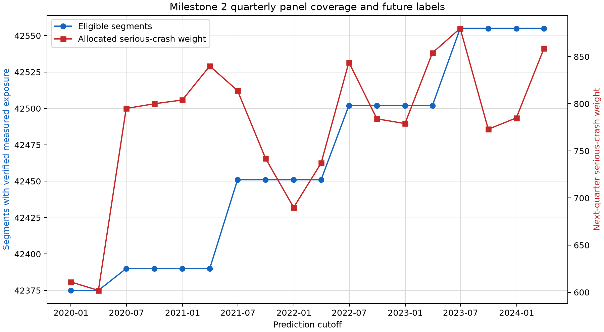
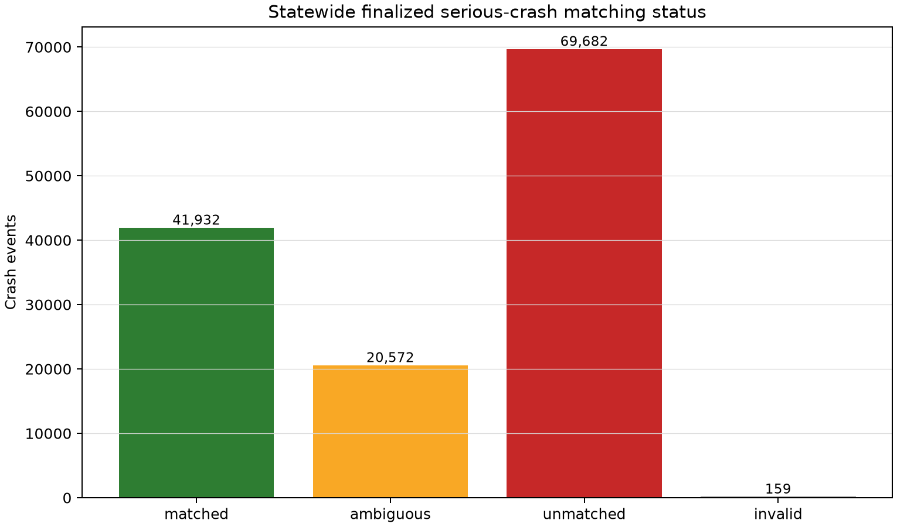

# Milestone 2 Bounded Exploratory Analysis

This analysis is intentionally limited to questions needed to approve the panel. It does not fit,
select or compare predictive models.

## What the panel looks like

The table is a balanced structural grid of 48,759 current state-controlled segments at 18 quarterly
cutoffs. Exposure eligibility is not balanced: 764,342 of 877,662 rows (87.088%) qualify for the
primary analysis. Unique eligible segments rise modestly over time as annual traffic releases
become available.

The primary label is rare. Among eligible rows, 97.744% have zero serious-crash weight in the next
quarter. Across the complete road grid, quarterly allocated serious-crash weight ranges from 602 to
880 events. This rules out accuracy as a useful headline metric and supports the planned count,
calibration and fixed-budget recall views.

## Why the label is weighted

Ambiguous intersection events legitimately touch multiple candidate segments. Giving every
candidate a full positive label would create more apparent crashes than were reported: for example,
the first panel quarter contains 864 positive candidate-segment rows but only 611 conserved units
of serious-crash weight. Fractional allocation preserves the event total while keeping the
ambiguity visible.

## Road length and graph structure

The road network contains many short urban pieces and fewer very long regional pieces. Median
segment length is 174.712 m, compared with a 95th percentile of 3.044 km and a maximum of 78.490
km. Segment-level ranking can therefore privilege network segmentation density unless Milestone 3
reports length sensitivity and uses exposure-aware comparisons.

The endpoint graph has 24 connected components and only 16 isolated segments. That is sufficient
for later graph-derived features, but topology alone is not evidence that a graph model will add
predictive value. The baseline-first order remains mandatory.

## Coverage patterns

Highway, Secondary and Connector roads have verified historical AADT on more than 85% of segments
and more than 95% of length. Motorway coverage is lower (63.491% of segments and 61.698% of
length), while Busway, Track and Ferry coverage is effectively absent. These classes require an
explicit coverage tier rather than imputation disguised as measurement.

Large-LGA coverage is also uneven. Brisbane City has verified historical exposure for 64.282% of
its state-road segments and 59.972% of their length, materially below Rockhampton Regional's
87.528% of segments and 96.050% of length. A geographic holdout result without these denominators
would be misleading.

## Crash matching pattern

Just under half of finalized serious crashes are matchable to the state-controlled network under
the current rule; the rest are mostly outside the restricted population. Within matchable events,
ambiguity is common enough that nearest-only labels would materially change segment outcomes. The
saved candidates and allocation bridge make later threshold sensitivity possible without losing
the original audit trail.

## Implications for Milestone 3

1. Use the weighted count target and fixed-budget captured weight as primary outcomes.
2. Keep all baselines on the same cutoff-specific eligible population.
3. Include segment length or exposure offsets where the method supports them.
4. Report results by road class, geography, remoteness and exposure tier.
5. Run matching-radius, segment-length and exposure-availability sensitivity checks.
6. Calibrate uncertainty and prefer abstention where coverage is weak.

These are design implications from observed coverage and sparsity, not claims of model performance.

