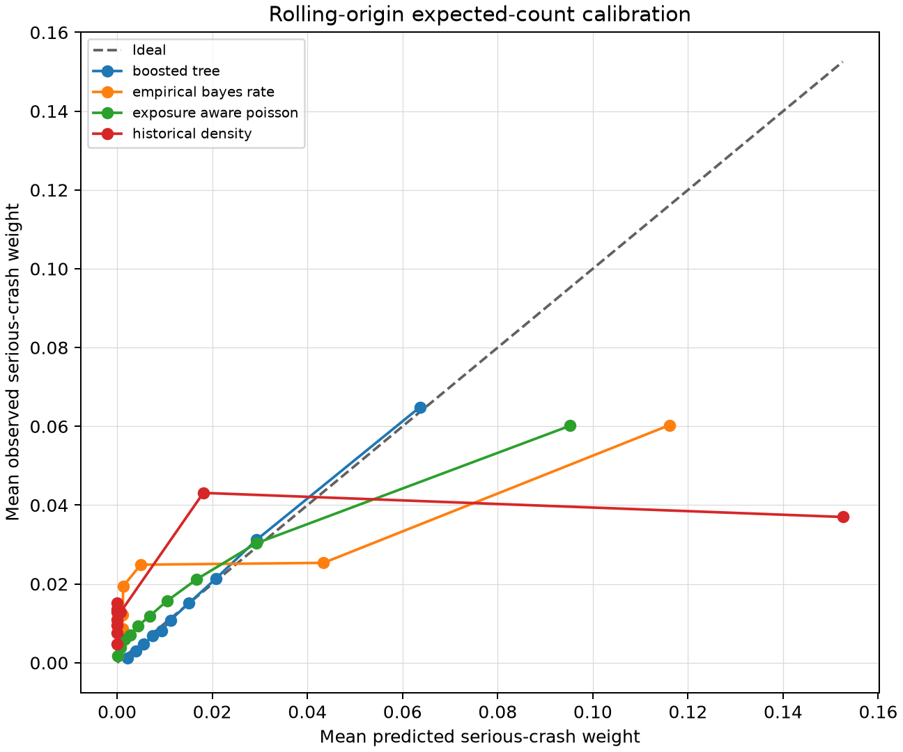

# Milestone 3 Calibration and Uncertainty

## Method

Each fold reserves four chronological quarters after training for calibration. Two adjustments are
estimated without touching the test period:

1. a multiplicative expected-count correction, equal to calibration observed weight divided by
   raw predicted weight;
2. a 90% split-conformal interval radius from absolute calibration residuals.

The interval is intentionally simple and auditable. It measures outcome uncertainty under the
calibration distribution; it does not separately quantify network-history error, exposure error or
map-matching ambiguity.

## Expected-count calibration

Boosted-tree test observed/predicted count ratios across the three rolling folds are 0.928, 1.041
and 1.008. Exposure-aware Poisson ratios are 0.968, 1.018 and 0.997. The later folds are close in
aggregate count, although decile-level reliability and ranking performance still differ.

Mean rolling Brier scores for the Poisson-derived occurrence probability are 0.02215 for boosted
trees, 0.02248 for exposure-aware Poisson, 0.02257 for empirical Bayes and 0.02454 for historical
density. These probabilities are secondary diagnostics because the primary target is conserved
crash weight rather than a duplicated candidate-segment occurrence label.

## Interval coverage

| Baseline | Rolling mean coverage | Brisbane coverage | Brisbane mean width |
|---|---:|---:|---:|
| Boosted tree | 89.68% | 83.33% | 0.0593 |
| Empirical Bayes | 89.77% | 82.87% | 0.0888 |
| Exposure-aware Poisson | 89.83% | 80.86% | 0.0652 |
| Historical density | 89.70% | 76.59% | 0.0582 |

Rolling coverage is close to the nominal 90% target. Every method undercovers in the geographic
holdout, demonstrating that chronological calibration alone does not guarantee transfer to an
unseen city. The boosted tree's Brisbane observed weight also exceeds its predicted total by about
6.9%.

## Interpretation and allowed use

The intervals are useful baseline diagnostics, not deployment-ready guarantees. They are marginal
over the evaluated eligible rows and do not establish 90% coverage in every road class, region or
individual segment. Milestone 5 must revisit calibration with subgroup diagnostics, distribution
shift detection and an abstention policy.

Until then:

- show point estimates and intervals together;
- retain exposure and map-matching quality flags;
- do not present the upper bound as a causal or worst-case crash forecast;
- do not claim calibrated reliability for all Queensland roads or held-out geographies.

