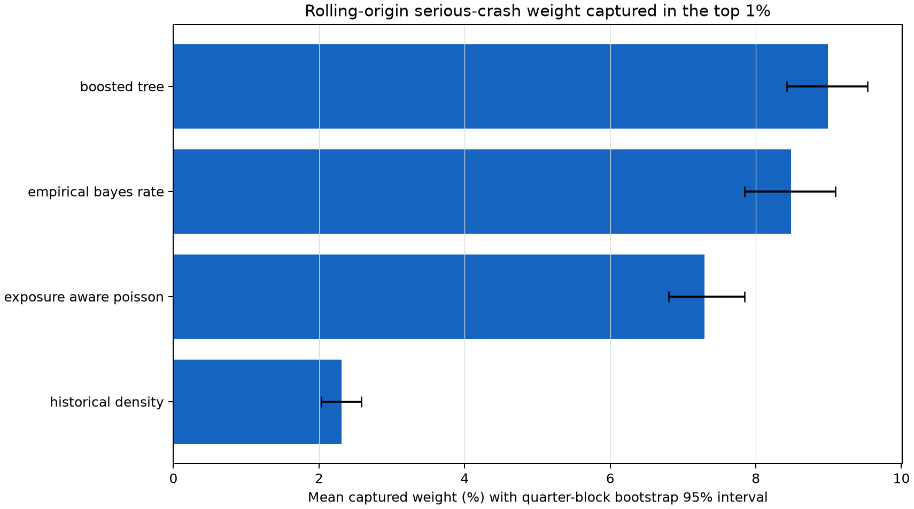

# Milestone 3 Rolling-Origin and Geographic Evaluation

## Evaluation contract

All experiments use `serious_crash_weight_next_1q` on rows where
`eligible_for_primary == true`. No random split is used. Encoders and model parameters are fitted
only on training rows; a later four-quarter block is used for calibration and the following
four-quarter block for testing.

| Fold | Training cutoffs | Calibration cutoffs | Test cutoffs | Test rows |
|---|---|---|---|---:|
| Rolling 1 | 2019 Q4–2020 Q1 | 2020 Q2–2021 Q1 | 2021 Q2–2022 Q1 | 169,804 |
| Rolling 2 | 2019 Q4–2021 Q1 | 2021 Q2–2022 Q1 | 2022 Q2–2023 Q1 | 170,008 |
| Rolling 3 | 2019 Q4–2022 Q1 | 2022 Q2–2023 Q1 | 2023 Q2–2024 Q1 | 170,220 |
| Brisbane transfer | Rolling 3 dates outside Brisbane | Rolling 3 dates outside Brisbane | 2023 Q2–2024 Q1, Brisbane only | 10,696 |

The Brisbane transfer fold contains 2,674 eligible segments. Brisbane City is absent from its
397,374 training rows and 159,312 calibration rows. Target windows are adjacent but do not overlap.

## Baseline definitions

- **Historical density:** trailing 20-quarter serious-crash allocation weight per kilometre.
- **Empirical Bayes:** segment history shrunk toward a training-only road-class crash rate using a
  four-quarter prior exposure strength.
- **Exposure-aware Poisson:** regularised log-linear rate model; quarterly VKT proxy acts as the
  Poisson exposure offset equivalent through rate fitting and exposure weights.
- **Boosted tree:** deterministic LightGBM Poisson model using lagged crash features, exposure,
  length, AADT, graph degree, season, road class and TMR region. It uses no neighbour aggregation,
  graph embedding or future information.

Hyperparameters were fixed in `configs/base.yaml` before the final test was read. Each model's raw
expected count is multiplied by a factor fitted on its calibration block.

## Primary fixed-budget result

The predeclared selection metric is mean captured serious-crash weight in the top 1% of eligible
segments, averaged across 12 future test quarters. Confidence limits resample complete quarter
blocks rather than treating segment rows as independent.

| Baseline | Mean top-1% capture | Quarter-block bootstrap 95% interval | Brisbane top-1% capture |
|---|---:|---:|---:|
| Boosted tree | **8.992%** | 8.425%–9.535% | 6.691% |
| Empirical Bayes | 8.485% | 7.848%–9.092% | **7.481%** |
| Exposure-aware Poisson | 7.297% | 6.803%–7.843% | 6.203% |
| Historical density | 2.312% | 2.029%–2.583% | 1.889% |

The overlapping boosted-tree and empirical-Bayes intervals mean their chronological difference is
not treated as conclusive. Boosted tree is selected because the protocol required a single
reference baseline and its mean is highest, not because empirical Bayes has been invalidated.

## Other investigation budgets

Mean chronological captured serious-crash weight:

| Baseline | Top 50 | Top 100 | Top 250 | Top 1% | Top 5% |
|---|---:|---:|---:|---:|---:|
| Boosted tree | 1.90% | 3.30% | 6.35% | 8.99% | 25.96% |
| Empirical Bayes | 1.88% | 3.17% | 6.15% | 8.48% | 23.23% |
| Exposure-aware Poisson | 1.54% | 2.46% | 4.97% | 7.30% | 22.89% |
| Historical density | 0.34% | 0.63% | 1.47% | 2.31% | 10.40% |

In Brisbane, boosted trees lead at top 50, 100, 250 and 5%, while empirical Bayes leads at the
specific top-1% selection budget. Operational conclusions therefore depend on actual investigation
capacity.

## Count and rare-event metrics

Mean rolling-origin values:

| Baseline | Poisson deviance | Brier score | 90% interval coverage |
|---|---:|---:|---:|
| Boosted tree | **0.1120** | **0.02215** | 89.68% |
| Exposure-aware Poisson | 0.1204 | 0.02248 | 89.83% |
| Empirical Bayes | 0.1436 | 0.02257 | 89.77% |
| Historical density | 0.4361 | 0.02454 | 89.70% |

The models improve meaningfully on historical density, but absolute average precision remains low
because next-quarter serious crashes are rare.

## Subgroup findings

For the boosted-tree top-1% list, mean within-group captured weight is 34.67% for motorway events,
7.36% for highway, 6.81% for secondary, 3.85% for connector and 2.44% for the small local class.
No busway or restricted crash weight was captured in the reported test quarters. By segment-length
band, capture ranges from under 1% in the two shortest bands to 17.08% in the longest quartile.

These figures expose selection concentration; they do not imply motorway or long-segment crashes
are more preventable. Complete subgroup artifacts also cover TMR region and left-side LGA.

## Ranking stability

Mean adjacent-quarter top-1% Jaccard overlap is 0.793 for boosted tree, 0.792 for empirical Bayes,
0.919 for exposure-aware Poisson and 0.865 for historical density. The Poisson ranking is more
stable, but that stability comes with lower crash capture. Operational use will need a deliberate
trade-off between responsiveness and list churn.

